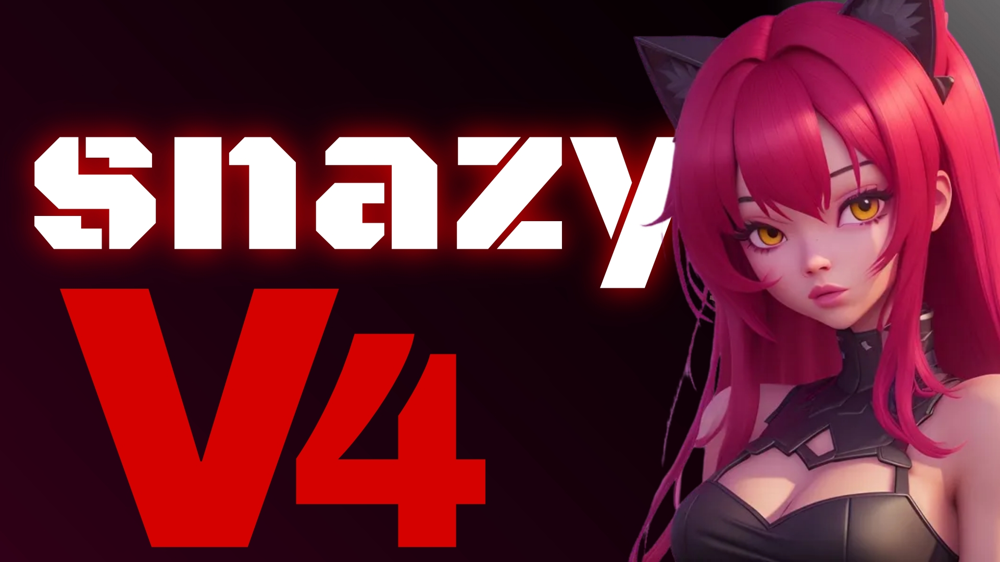

# 🚀 SNAZY Optimizer V4.4.2

  

  **Boost Your Performance. Take Control. Game Smarter.**

  A powerful Android optimization app designed to enhance your gaming experience with smart performance tools, network optimization, in-app purchases, and more.

---

## 🆕 What's New in V4.4.2

### 🛒 In-App Purchases

* Purchase supported premium features directly inside the app.
* A simpler way to access available premium options.
* Convenient in-app purchasing experience.

### 💬 In-App Support

* Access support directly from SNAZY Optimizer.
* Get help with app features and common issues.
* Find assistance without leaving the app.

### 📢 In-App Announcements

* Stay updated with important announcements.
* Discover new features, updates, and information.
* Receive app-related news directly inside SNAZY Optimizer.

### 🌐 Network Boost

* Network optimization tools for gaming.
* Designed to help improve connection consistency.
* Helps you manage network-related gaming settings.

*Actual network performance depends on your internet connection, mobile carrier, Wi-Fi quality, and device.*

---

## ⚡ Key Features

### 🎮 In-Game Super Panel Turbo

* Quick access to supported gaming tools.
* In-game control panel for a more convenient experience.
* Access supported features while gaming.

### 🚀 Turbo Boost

* One-tap performance optimization.
* Designed to prepare your device for gaming.
* Helps manage background activity.

### 🎵 In-Game Music Player

* Enjoy music while playing supported games.
* Convenient music controls for gaming sessions.

### 📱 Device Status Monitor

* View supported device status information.
* Monitor available performance and device indicators.

### ⏱️ Gaming Timer

* Use the built-in timer during gaming sessions.

### 🔕 Gaming Do Not Disturb

* Reduce interruptions while gaming using supported DND controls.

### 🔋 Charging Optimization

* Access supported charging-related optimization tools.

### 🎨 Color Customization

* In-app color customization.
* Supported game color adjustment tools.

### 🎯 Pro Sensitivity for Device

* Select a supported game.
* Enter your phone model to receive suggested sensitivity values.
* Use the suggestions as a starting point and fine-tune them in-game.

### 🖥️ Per-Game Display Optimization

* Configure supported per-game refresh-rate and resolution preferences.
* Restore display settings when finished.
* Requires compatible device support and Root or Shizuku access for applicable controls.

### 🧊 Background App Management

* Manage selected background apps during gaming.
* Restore apps or settings using supported restore controls.

### 📊 Floating Status Overlay

* Access supported device status information while gaming.

### 🎥 Screen Recorder

* Access screen recording features where supported by your device and Android version.

### 👑 SNAZY Pro

* Access available premium features and options.
* Manage supported Pro features from within the app.

### 👤 Account System

* Sign in with supported Google login functionality.
* Access account-related features available in your app version.

### 🛠️ Root & Shizuku Support

* Root-enabled features on supported rooted devices.
* Shizuku-based controls for supported non-root devices.
* Some features require additional permissions or compatible Android versions.

---

## ✨ Designed for a Better Experience

* Modern premium-style interface.
* Smooth animations and convenient controls.
* Easy access to gaming tools.
* Integrated support and announcements.
* Continuous improvements to performance tools and usability.

---

## 📱 Compatibility

* **Platform:** Android
* **Android version:** Depends on the feature and device compatibility.
* **Root:** Required for certain advanced system controls.
* **Shizuku:** Required for supported non-root system controls.
* **Internet:** Required for online features such as purchases, account services, and announcements.

Some features may not work on every device. Availability depends on Android version, manufacturer restrictions, permissions, and hardware support.

---

## ⚠️ Disclaimer

SNAZY Optimizer is an independent Android utility. It cannot guarantee higher FPS, lower ping, or improved internet speeds on every device or network. Results vary depending on device hardware, game settings, and network conditions.

Use system-level features carefully and review any requested permissions before granting access.

---

## 📥 Download

Visit the **[SNAZY Optimizer GitHub Repository](https://github.com/sethikaDV/Snazy-optimizer-)** to find available releases and downloads.

---

## 👨‍💻 Developer

**Developer:** [@sethikaDV](https://github.com/sethikaDV)

**Project:** SNAZY Optimizer

---

  **SNAZY Optimizer V4.4.2 — Optimize Smarter. Game Better.** 🚀

